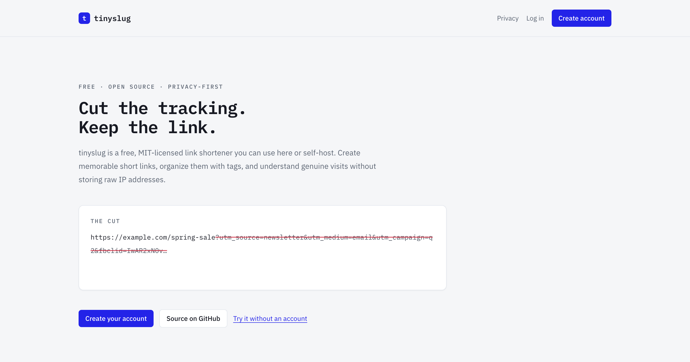
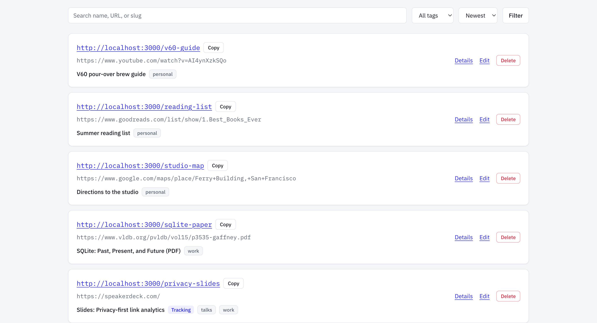
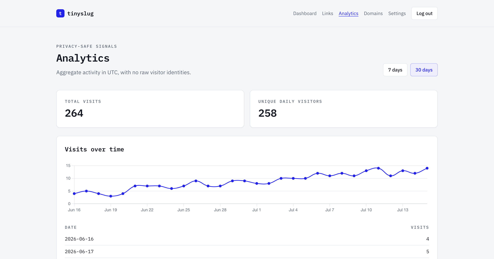
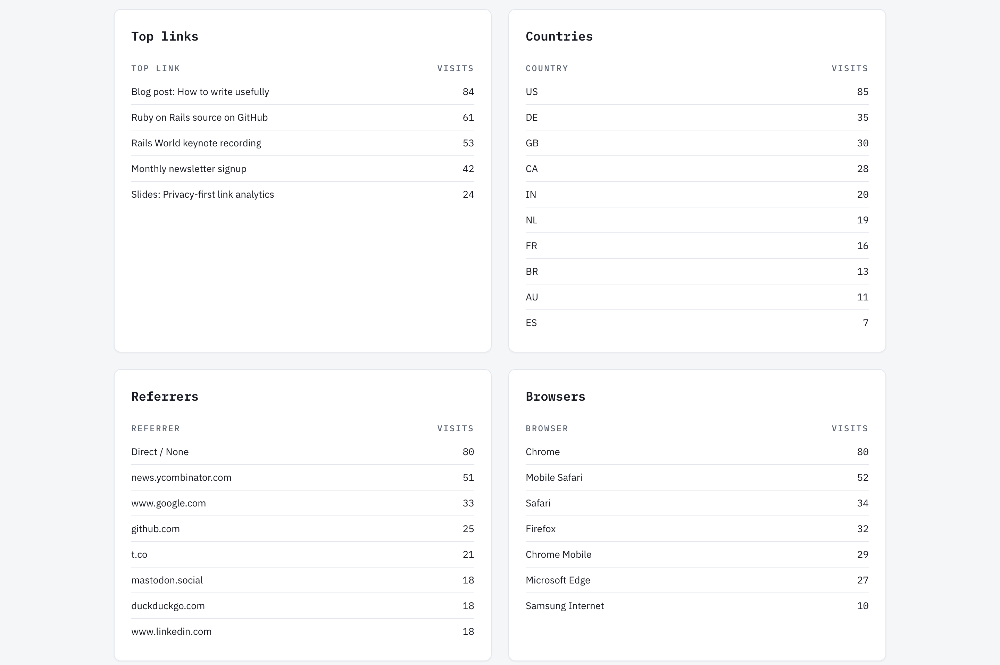

# tinyslug

tinyslug is a privacy-focused, self-hostable link manager built with Rails 8.1, Hotwire, Tailwind CSS, PostgreSQL, and Solid Queue. It provides short links, tags, QR codes, privacy-preserving analytics, custom domains, and an authenticated API.



## Screenshots







## Requirements

- [mise](https://mise.jdx.dev/)
- PostgreSQL 17 through Docker Compose or a supported native PostgreSQL installation

Ruby 4.0.6 is pinned in `mise.toml`; no global Ruby, Rails, Bundler, or Node installation is used.

## Setup

Install Ruby and start PostgreSQL:

```sh
mise install
docker compose up -d postgres
```

Use `.env.example` as the environment-variable reference when overriding local defaults, then prepare the application:

```sh
mise exec -- bin/setup
mise exec -- bin/dev
```

For native PostgreSQL, ensure `pg_isready` succeeds and that your operating-system user can create the `tinyslug_development`, `tinyslug_development_queue`, and `tinyslug_test` databases. `DATABASE_URL`, `QUEUE_DATABASE_URL`, and `TEST_DATABASE_URL` can override socket-based defaults.

Open <http://localhost:3000>. Development email is written to `tmp/mails`; open the newest HTML part to follow a confirmation or password-reset link.

Optional idempotent demo data is available with `mise exec -- bin/rails db:seed`. It creates `demo@tinyslug.local` with the local-only password `demo-password-change-me` (override it with `SEED_DEMO_PASSWORD`), ten tagged sample links, and thirty days of privacy-safe visit history for the analytics dashboard.

## Validation

Run the same validation entry point used in CI:

```sh
mise exec -- bin/ci
```

Individual checks are available through `mise exec -- bin/rails test`, `mise exec -- bin/rubocop`, `mise exec -- bin/brakeman --no-pager`, and `mise exec -- bin/importmap audit`.

## Runtime processes

`mise exec -- bin/dev` starts the web process and Tailwind watcher. Run `mise exec -- bin/jobs` in a second process for redirect analytics and recurring work. Production deployments must run both the web image and at least one job worker.

## Configuration

`.env.example` documents every supported setting. Production requires `APP_HOST`, `DATABASE_URL`, `SECRET_KEY_BASE`, `VISITOR_DIGEST_SECRET`, `API_TOKEN_DIGEST_SECRET`, and `RATE_LIMIT_DIGEST_SECRET`. Each digest secret must be independent.

See `docs/operations.md` for deployment, SMTP, custom-domain DNS/TLS, backups, and worker runbooks. `docs/routes.md` records every route area's authentication decision.

## Privacy

tinyslug never persists raw visitor IP addresses, full referrer URLs, query strings, or raw user agents. Tracking is opt-in per link and honors DNT, GPC, and bot exclusions. Daily rotating digests prevent durable cross-day visitor identification.

## Contributing and security

See [CONTRIBUTING.md](CONTRIBUTING.md), [CODE_OF_CONDUCT.md](CODE_OF_CONDUCT.md), and [SECURITY.md](SECURITY.md). tinyslug is available under the [MIT License](LICENSE).
